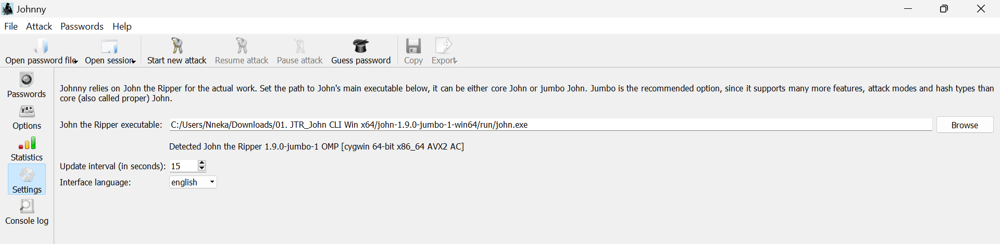
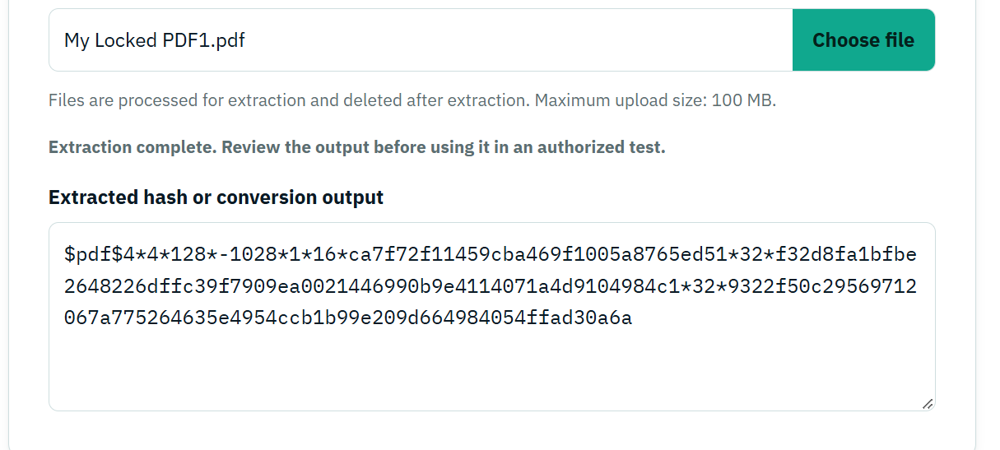
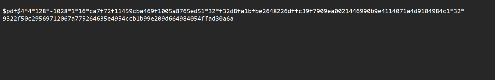
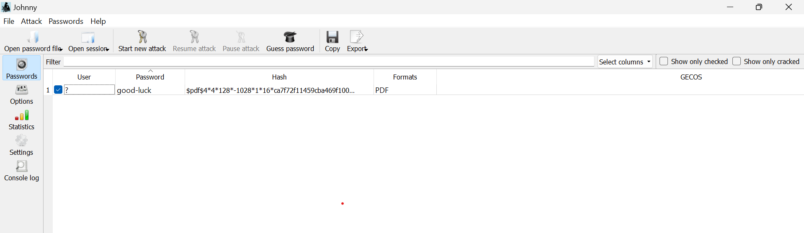
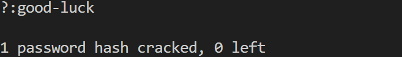
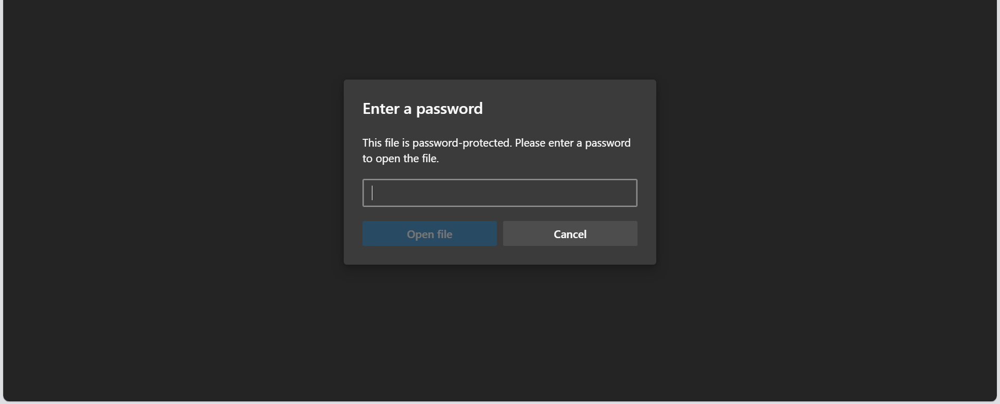

# W3-PM1 — Password Cracking with JTR

**Student Name:** Akalonu Emmanuella Nneka  
**Student ID:** B084A  
**Course:** Cybersecurity & Ethical Hacking W3-PM1

## Objective
Recover the password of the provided locked PDF file (`My Locked PDF2.pdf`) using **John the Ripper (JTR) Jumbo** and its graphical front-end **Johnny**, then verify the recovered password by opening the PDF.

## Environment
| Item | Value |
|---|---|
| Operating System | Windows 11 |
| JTR Build | John the Ripper 1.9.0-jumbo-1-win64 |
| GUI | Johnny 2.2 (Windows) |
| Lab File | `My Locked PDF2.pdf` |
| Hash Type | `$pdf$` |
| Recovered Password | `good-luck` |

> This work was performed only on the authorized lab file provided for this training module.

## Tools Used
1. **John the Ripper Jumbo** — actual cracking engine (`john.exe`).
2. **Johnny 2.2** — graphical front-end for John.
3. **OnlineHashCrack PDF Hash Extractor** — extracts the `$pdf$...` hash from the locked PDF.
4. **Notepad** — stores the hash in `pm1-hash.txt`.
5. **Windows PowerShell** — verifies the result with `john.exe --show`.

## Steps Performed

### 1. Installed John the Ripper Jumbo
- Downloaded the Windows Jumbo build.
- Extracted to `C:\Users\Nneka\Downloads\01. JTR_John CLI Win x64\john-1.9.0-jumbo-1-win64\run`.
- Confirmed the executable `john.exe` exists.

### 2. Installed and configured Johnny
- Installed Johnny 2.2 for Windows.
- Opened **Settings**, clicked **Browse**, and pointed Johnny to `run\john.exe`.
- Johnny successfully detected John the Ripper 1.9.0-jumbo-1.

### 3. Extracted the PDF hash
- Opened the OnlineHashCrack PDF Hash Extractor.
- Uploaded `My Locked PDF2.pdf`.
- The tool returned a hash beginning with `$pdf$...`.
- Copied the **complete** hash and pasted it into Notepad on a **single line**.
- Saved the file as `pm1-hash.txt` (UTF-8).

### 4. Loaded the hash into Johnny
- Opened Johnny.
- Clicked **Open password file → Open password file (Hash format)**.
- Selected `pm1-hash.txt`.
- The hash appeared in Johnny with format **PDF**.

### 5. Started the attack in Johnny
- Clicked **Start new attack**.
- Used the default attack settings.
- The **Password** column displayed the recovered password.

### 6. Verified with John the Ripper CLI
Opened PowerShell in the JTR `run` folder and executed the verification command:

    .\john.exe --show --format=pdf "C:\...\pm1-hash.txt"

Output confirmed the password:

    ?:good-luck
    
    1 password hash cracked, 0 left

### 7. Opened the PDF with the recovered password
- Double-clicked `My Locked PDF2.pdf`.
- Entered the recovered password: `good-luck`.
- The PDF opened successfully and displayed the lab Congratulations / flag page.

## Troubleshooting Notes
- **Johnny: "No valid John executable"** → Resolved by browsing to `run\john.exe` instead of `johnny.exe`.
- **John: "No password hashes loaded"** → Resolved by ensuring the hash file (`pm1-hash.txt`) contained only the single-line `$pdf$...` string without `b'` prefixes or line breaks.
- **PowerShell path errors** → Resolved by wrapping the long file paths in double quotes (`" "`).

## Evidence

### Screenshots

## Conclusion
John the Ripper Jumbo and Johnny successfully recovered the password of the locked lab PDF. The hash extracted from the PDF (`$pdf$...`) was loaded into Johnny and cracked; the CLI `john.exe --show` confirmed the result. The recovered password `good-luck` opened the PDF successfully.

This exercise demonstrates that short, common dictionary phrases can be cracked quickly. Password-protected files should use long, unique, high-entropy passwords, and sensitive documents should be protected with strong encryption.

## Ethical Use / Scope
All cracking activity was performed only on the lab file provided for this training module, on my own machine, for educational purposes. No real user data or unauthorized systems were involved.
