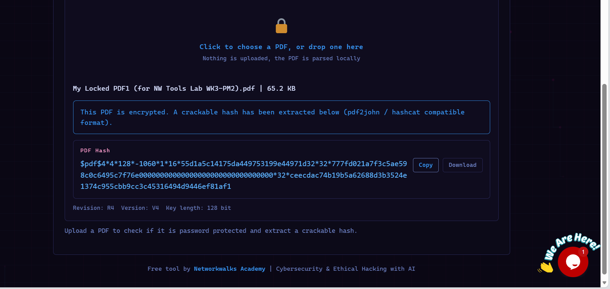
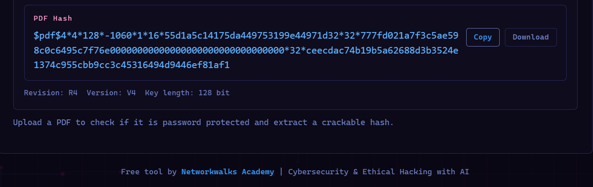
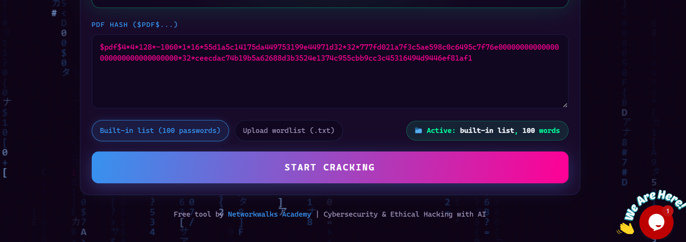
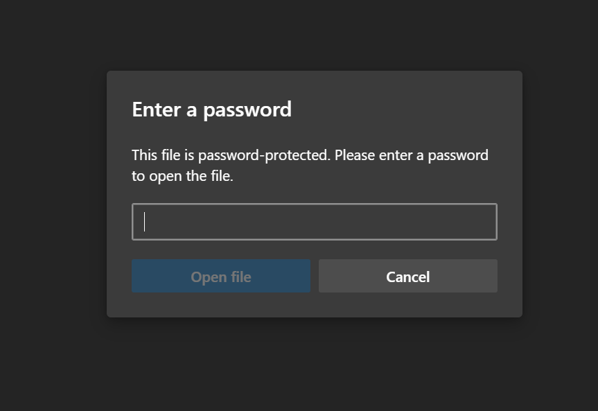

---

# W3-PM2 — Password Cracking with Networkwalks Tools

**Student Name:** Akalonu Emmanuella Nneka   
**Student ID:** B084A  

## Objective
Recover the password of the provided locked PDF file (`My Locked PDF2.pdf`) using the browser-based **Networkwalks Hash Calculator** and **Networkwalks Password Cracker**.

## Environment
| Item | Value |
|---|---|
| Operating System | Windows 11 |
| Tools | Networkwalks Hash Calculator, Networkwalks Password Cracker |
| Lab File | `My Locked PDF2.pdf` |
| Hash Type | `$pdf$`|
| Recovered Password | `good-luck` |

## Steps Performed
1. Opened the Networkwalks Hash Calculator in a web browser.
2. Uploaded `My Locked PDF2.pdf` to extract the `$pdf$...` hash.
3. Saved the extracted hash into `pm2-hash.txt` in the project directory.
4. Opened the Networkwalks Password Cracker and pasted the extracted hash.
5. Clicked "Start Cracking" and the tool successfully recovered the password: `good-luck`.
6. Opened the PDF using the recovered password to verify access to the document.

## Evidence

### Screenshots

## Conclusion
The Networkwalks Hash Calculator and Password Cracker successfully extracted and cracked the password (`good-luck`) for the locked lab PDF (`My Locked PDF2.pdf`). This module demonstrates how easily accessible browser-based tools can crack weak dictionary passwords, highlighting the critical need for strong, unique passwords and robust encryption for sensitive files.

## Ethical Use / Scope
All cracking activity was performed strictly on the authorized lab file provided for this educational module on a personal machine.